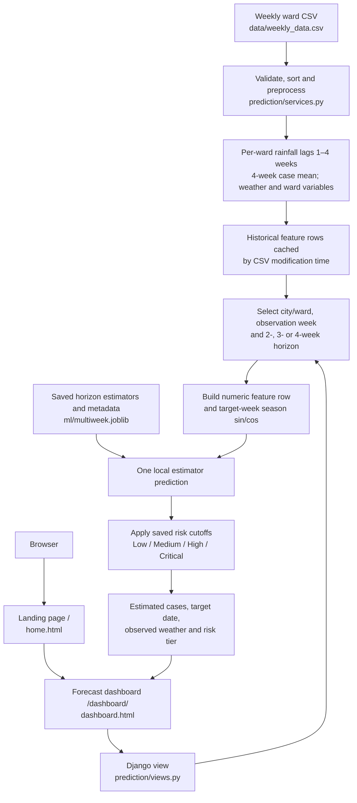
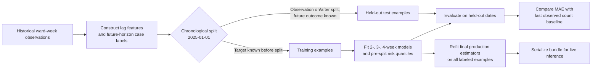

# DengueGuard — System Architecture

**Challenge:** AI for Urban Dengue Outbreak | **Scope:** local, ward-level 2–4-week early-warning prototype

## 1. System and data flow

**Implementation:** `config/urls.py` includes `prediction/urls.py`. The `/` route renders a separate landing page; `/dashboard/` renders the prediction dashboard. `prediction/views.py` handles query selections and bilingual display. `prediction/services.py` prepares records and performs inference. This is one Django application, not two web servers.

## 2. Inputs, preprocessing and model rationale

- **Dataset:** `data/weekly_data.csv` contains **31,320 ward-week rows**, **60 city–ward combinations** across **5 cities**, dated **2016-01-04 through 2025-12-29**. Each row includes city, ward ID, date, dengue cases, temperature (`avg_temp_c`, `max_temp_c`, `min_temp_c`), `rainfall_mm`, `relative_humidity_pct`, `population_density_sqkm`, `water_logging_risk_index`, and `sanitation_score`.
- **Validation:** convert date and numeric fields, reject empty/missing/nonfinite values and duplicate `(city, ward_id, date)` keys, sort within wards, and require seven-day intervals between consecutive records.
- **Weather-lag pipeline:** within each `(city, ward_id)` group, shift rainfall by **1, 2, 3 and 4 weeks**. Calculate `cases_four_week_mean` over the current observation week and three preceding weeks. Discard records without complete lag history; the dashboard only offers remaining observation dates.
- **Inference features:** append sine/cosine seasonality derived from the **target week's** day-of-year; select numerical columns in the exact order stored as `features` in the model bundle. The target date equals the observation date plus the selected horizon.
- **Model choice:** the supplied architecture describes **three separately trained histogram gradient boosting regressors**, one each for **2, 3 and 4 weeks**, with **Poisson loss** for nonnegative case counts. Tree boosting models nonlinear associations among rainfall history, weather, recent cases and ward characteristics; separate horizon models avoid assuming the same lag relationships at each lead time. At runtime, the saved `models[horizon]` estimator produces a case estimate. Saved `risk_cutoffs` classify the **unrounded** estimate into Low, Medium, High or Critical; only the displayed case number is rounded to two decimals. Weather values shown are observed inputs, **not explanations of causal feature importance**.

## 3. Chronological validation and leakage controls

The **documented training methodology** splits at **1 January 2025**. Training labels must be observed **before** the cutoff; held-out examples have observations **on or after** the cutoff and known future targets. This protects the evaluation from using future target counts during training. The baseline carries the most recently observed ward case count forward. Risk thresholds are documented as derived from pre-split quantiles of positive cases.

| Horizon | Held-out ward-weeks | Reported model MAE | Reported baseline MAE |
| ------- | ------------------: | -----------------: | --------------------: |
| 2 weeks |               3,000 |               1.05 |                  1.80 |
| 3 weeks |               2,940 |               1.19 |                  2.11 |
| 4 weeks |               2,880 |               1.38 |                  2.34 |

**Evaluation boundary:** These counts and MAEs are reported by the project's existing documentation and displayed in `prediction/views.py`; the training notebook is **not included in the supplied ZIP**, so they are **not independently reproducible from this repository alone**. After evaluation, production estimators were reportedly refit using all labeled examples. Consequently, selecting an old observation date in the dashboard is **not** a new held-out backtest and should not be presented as one.

## 4. Runtime, compute and API cost controls

- **One-time loading per worker:** `@lru_cache(maxsize=1)` retains the joblib model bundle; it is not reloaded for each request.
- **Data caching:** prepared CSV history is cached with `@lru_cache(maxsize=2)`, keyed by file path and nanosecond modification time; modifying the CSV triggers a new cached preparation on the next request.
- **Bounded local inference:** one selected feature row is scored by one horizon-specific estimator per forecast request. The inference block limits OpenMP threads to **one** using `threadpoolctl`.
- **Zero inference API spend:** no weather API, hosted model endpoint or LLM call is required by the runtime. No map-tile, analytics or external-font service is required. Normal first-time installation still downloads Python dependencies.
- **Local presentation state:** the language choice is persisted in a `dg_lang` cookie; the browser stores theme preference locally. Django development-server settings are for a local hackathon demo, **not a production security/deployment configuration**.

## 5. Requirement traceability and limits

| Preliminary-round requirement             | Implementation / evidence                                                                                                                                                                    |
| ----------------------------------------- | -------------------------------------------------------------------------------------------------------------------------------------------------------------------------------------------- |
| Multi-week weather pipeline               | `services.load_history()` validates ward sequences, computes grouped rainfall lags 1–4 weeks and rolling cases.                                                                              |
| Dynamic outbreak prediction               | `services.forecast()` uses saved scikit-learn estimators and saved risk cutoffs for selected wards and 2–4-week horizons.                                                                    |
| Interactive user interface                | `home.html` provides entry; `/dashboard/` offers ward, observation-week and horizon selection with weather values and risk classification.                                                   |
| Architecture and chronological evaluation | This document covers data flow, model choice, the reported split and held-out MAE comparison.                                                                                                |
| Compute and API efficiency                | Cached local joblib inference, CSV mtime caching, one-row scoring and no runtime external APIs.                                                                                              |
| Reproducible setup                        | `requirements.txt`, `README.md`, `RUN_WINDOWS.bat` and `python manage.py test`; **≤3-minute setup has not been benchmarked**.                                                                |
| Demo video and Git/AI disclosure          | These are **submission deliverables**, not architecture features: record a ≤3-minute uncut live demonstration; verify distributed Git commits and complete AI/API disclosure in `README.md`. |

**Not implemented or not established by the supplied project:** live weather ingestion, continuously updated outbreak surveillance, ward heatmaps, prediction confidence intervals, automated retraining, and independently reproducible model-training experiments. Do not describe these as existing capabilities. The system provides **estimated case counts and relative risk tiers**, not causal conclusions or validated operational public-health guidance.
